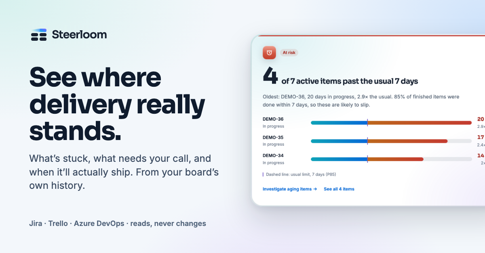

# Steerloom



**A delivery briefing for the person running the team:** which work needs a
decision, the board and code evidence behind it, and what to check next.

Steerloom reads your board's history (Jira, Trello or Azure DevOps) and,
optionally, your GitHub pull requests. It turns them into a short briefing:
what is late, where work piles up, when the current work is likely to finish,
and where the board and the code tell different stories. It only reads. It
never changes a board, a ticket or a repository.

## Try it

| Way                      | What you need                           | Where                                        |
| ------------------------ | --------------------------------------- | -------------------------------------------- |
| **Demo**                 | Nothing. Fictional data, in the browser | <https://steerloom.app/?demo=1>              |
| **On your own computer** | One pasted command, no account          | <https://steerloom.app/?hosted=1&page=local> |
| **Hosted**               | A free account                          | <https://steerloom.app>                      |
| **From source**          | Node.js 20.19 or newer                  | [Run from source](#run-from-source), below   |

The version on your own computer is the one to use with a company board: the
board data and your tokens stay on that machine. It is also where GitHub
connects.

## What it shows

- **What needs a decision today.** Items past your team's own usual time,
  work piling up in one stage, and more started than finished, each with the
  items behind it.
- **Board and code, read together.** Per item: branch, pull request, review
  and merge next to the board stage, and a list of where the two disagree
  ("in progress" on the board, merged four days ago in the code).
- **A forecast from your own history.** When the active work is likely to be
  done, with the range, and what it assumes.
- **Six flow numbers, each one explained.** Every number opens to show how it
  was calculated and which items set it.
- **Steerloom AI (optional).** Ask why something is stuck or what to raise
  today. It answers from the briefing's evidence and bounded, read-only checks
  on your board. It needs an AI key of your own (Anthropic, OpenAI, Gemini,
  Grok, or a company endpoint); the briefing works without one.

Steerloom never scores individuals. Signals are about work and stages, not
about people.

## How it handles your data

- **Read-only.** No write operations and no write scopes on any provider.
- **Calculated in the browser.** Board items, provider responses and chats are
  not stored or logged, locally or on the hosted site.
- **Tokens stay server-side.** Provider and AI credentials are encrypted
  (AES-256-GCM) and never returned to the browser. In the local version the
  "server" is your own computer.
- **No telemetry in the local version.** The hosted site keeps anonymous step
  counts, described in its [privacy notice](https://steerloom.app/privacy.html).
- **AI sees the minimum.** A reduced report and bounded evidence you allowed;
  never credentials, emails, attachments or worklogs.

Details: [Using Steerloom](docs/using-steerloom.md) and
[Providers, proxies and AI](docs/providers.md). Use Steerloom only with
projects and data you are allowed to access.

## Metrics at a glance

| Metric                 | Meaning                                                                        |
| ---------------------- | ------------------------------------------------------------------------------ |
| Cycle time             | Calendar time accumulated across visits to the stages you measure.             |
| Completed observations | Items whose latest qualifying exit is in the period; current work is excluded. |
| Median                 | Middle completed cycle time.                                                   |
| P85 ("usual")          | Time within which about 85% of items finished.                                 |
| Throughput             | Qualifying exits per week in the period.                                       |
| Late work              | Active items older than the P85 of finished ones.                              |

Period comparisons describe what happened; they do not prove a cause. Full
rules are in [metric definitions](docs/using-steerloom.md#metric-definitions).

## Run from source

Requires Node.js 20.19 or newer.

```bash
git clone https://github.com/Marto-Aleks/steerloom.git
cd steerloom
npm install
npm run dev
```

Open the address Vite prints, normally `http://127.0.0.1:5173/`. Create a
local account (password of at least 12 characters) and choose **Explore
demo**. No environment file is needed for the demo. Always use the same
hostname (`127.0.0.1` or `localhost`).

The development server only answers on your own machine; do not expose it.
Optional settings (proxy, AI endpoint, sign-in providers) go in `.env.local`:
copy `.env.example` and restart. Local data lives in `.flowlens/`, which Git
ignores.

To run the hosted version yourself (Supabase accounts, a Node server), see
[Hosted pilot](docs/hosted-pilot.md) and [Launch](docs/launch.md).

## Development

```bash
npm run dev           # local server on 127.0.0.1
npm run lint
npm run format:check
npm test
npm run build:hosted  # browser app, production server and the local package
```

Where things are:

| Folder      | What is in it                                                       |
| ----------- | ------------------------------------------------------------------- |
| `src/`      | The browser app (React, TypeScript): briefing, metrics, setup pages |
| `server/`   | Local and hosted servers: providers, AI, accounts, the installer    |
| `supabase/` | Database migrations for the hosted version                          |
| `docs/`     | User and operator guides                                            |

Conventions and guardrails for changes are in [AGENTS.md](AGENTS.md). The
short version: provider access stays read-only, secrets stay server-side, no
real company data in tests, and nothing scores a person.

## Contributing

Steerloom is maintained by one person, in spare time. Issues are welcome,
especially "this did not work on my board" with the provider and what you saw.
For a larger change, open an issue first so we can agree on the approach. A
pull request should pass the four checks above.

Found a security problem? Please report it privately:
[SECURITY.md](SECURITY.md).

## Troubleshooting

| Problem                   | Check                                                          |
| ------------------------- | -------------------------------------------------------------- |
| Connection refused        | Run `npm run dev` and keep the terminal open.                  |
| Jira connection fails     | Check the Jira link, the token and the project.                |
| Jira unreachable          | Check VPN or network access to your Jira, and `HTTPS_PROXY`.   |
| No boards                 | Confirm the project key and your Jira browse permission.       |
| No completed observations | Measure stages before the last one, or choose a longer period. |
| AI setup needed           | Add an AI key on the workspace page.                           |
| AI certificate error      | Set `FLOWLENS_AI_CA_FILE` to your organisation's CA file.      |
| Session expired           | Sign in again; sessions last eight hours.                      |

More in [Providers, proxies and AI](docs/providers.md).

## Documentation

| Document                                       | For          | Covers                                                      |
| ---------------------------------------------- | ------------ | ----------------------------------------------------------- |
| [Using Steerloom](docs/using-steerloom.md)     | Users        | Briefings, reviews, late work, AI, metric definitions       |
| [Providers, proxies and AI](docs/providers.md) | Users, ops   | Jira, Trello, Azure DevOps, GitHub, proxies, AI endpoints   |
| [Local setup](LOCAL-SETUP.md)                  | Users        | Installing and running the local version                    |
| [Authentication](docs/authentication.md)       | Users, ops   | Local accounts, Google sign-in, sessions                    |
| [Product pages](docs/product-site.md)          | Contributors | Landing and setup pages, the local package, visual identity |
| [Hosted pilot](docs/hosted-pilot.md)           | Operators    | Supabase project, migrations, roles                         |
| [Launch](docs/launch.md)                       | Operators    | Provider apps, the server, production addresses             |

## Licence

Steerloom's code is released under the [MIT licence](LICENSE): use it, change
it, ship it.

A few things in this repository are not covered by that licence:

- **The Steerloom name, logo, the Loomy character and the product film** in
  `public/video/`. Please give a fork its own name and mark.
- **Other companies' marks** in `public/brands/` (Jira, Trello, Azure DevOps,
  GitHub, Figma and the AI services). They belong to their owners; see
  [public/brands/README.md](public/brands/README.md).
- **Fonts.** Inter and Sora are under the SIL Open Font License.
